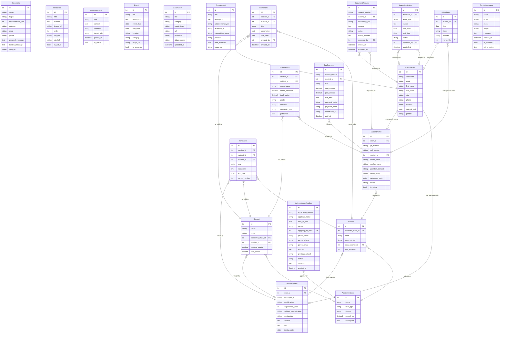

# 🗄️ Jupiter English Medium School — Database ER Diagram

> **School**: Jupiter English Medium School, Shendre, Satara, Maharashtra  
> **Database**: PostgreSQL 15  
> **ORM**: Django 4.2

---

## Entity Relationship Diagram

---

## 📊 Table Summary

| Model | Records (Est.) | Description |
|-------|---------------|-------------|
| CustomUser | 1,400+ | Students, Teachers, Staff, Admin |
| SchoolInfo | 1 | Singleton school identity record |
| TeacherProfile | 68+ | Extended teacher data |
| StudentProfile | 1,250+ | Active enrolled students |
| AcademicClass | 14 | Mini KG to Grade 10 |
| Section | 35+ | Class-wise sections |
| Subject | 100+ | All subjects per class |
| HeroSlide | 3–5 | Homepage hero banners |
| Announcement | 50+ | Notices and circulars |
| Event | 30+ | Annual calendar events |
| GalleryItem | 200+ | Photos and videos |
| Achievement | 50+ | Awards and records |
| AdmissionApplication | 500+ | Yearly applications |
| Attendance | 300,000+ | Daily per-student records |
| GradeResult | 50,000+ | Exam marks per subject |
| Homework | 2,000+ | Teacher assignments |
| FeePayment | 5,000+ | Annual invoices |
| DocumentRequest | 300+ | Certificate applications |
| LeaveApplication | 500+ | Annual leave requests |
| Timetable | 500+ | Weekly period entries |
| ContactMessage | 200+ | Public enquiries |

---

*© 2026 Jupiter Education Trust — Jupiter English Medium School, Shendre, Satara, Maharashtra*
